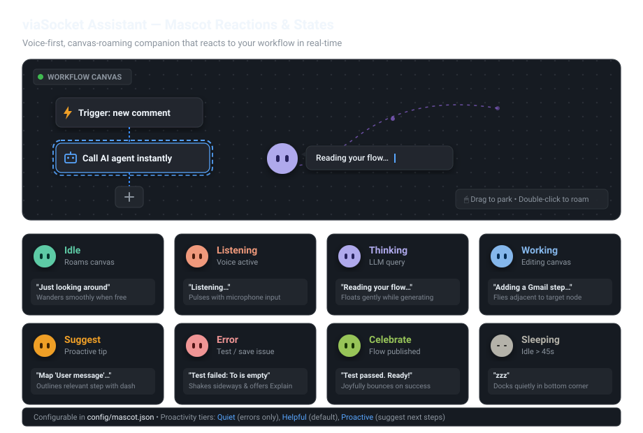

# viaSocket Assistant

An open-source (AGPL-3.0-or-later) Chrome extension that puts a voice-first, animated assistant on the viaSocket workflow canvas. A roaming bubble mascot with thinking text builds, edits and tests viaSocket workflows and Developer Hub plugs, using your own AI key, and reacts to what you do on the page.

Works on <https://flow.viasocket.com> and <https://beta-flow.viasocket.com>.

## Mascot reactions & canvas behavior

The assistant lives directly on your viaSocket workflow canvas as an animated bubble mascot. As you build, test, and publish workflows or Developer Hub plugs, the mascot changes its expression, color, and motion to reflect what's happening.

<p align="center">
  
</p>

> 🎮 **Interactive Prototype:** Open [docs/reactions-demo.html](docs/reactions-demo.html) in your browser to test roaming, dragging, parking, and all 8 reaction states.

### Reaction modes & moods

| Mode | Mood color | Eyes | Canvas motion | Example thinking text | When it happens |
|---|---|---|---|---|---|
| **Idle** | `#5DCAA5` (Sea green) | Open | Roams free areas of the canvas smoothly | *"Just looking around"* | Default roaming state when not working |
| **Listening** | `#F0997B` (Coral) | Open | Pulses gently with voice input | *"Listening…"* | Holding hotkey (`Ctrl+Option` / `Ctrl+Alt`) |
| **Thinking** | `#AFA9EC` (Lavender) | Open | Floats gently up and down | *"Reading your flow…"* | Awaiting model response or processing intent |
| **Working** | `#85B7EB` (Sky blue) | Open | Flies next to the active step | *"Adding a Gmail step…"* | Executing tool calls (creating/editing steps) |
| **Suggest** | `#EF9F27` (Amber) | Open | Outlines relevant node with dashed focus | *"Map 'User message' from trigger"* | Proactive suggestion on next workflow step |
| **Error / Confused** | `#F09595` (Soft red) | Open | Shakes horizontally side-to-side | *"Test failed: the To field is empty"* | Step test fails, save fails, or API error |
| **Celebrate** | `#97C459` (Lime green) | Open | Bounces joyfully upward | *"Test passed. Ready to publish"* | Test succeeds or flow published successfully |
| **Sleeping** | `#B4B2A9` (Muted gray) | Closed slits (`2px`) | Docks at bottom corner of canvas | *"zzz"* | Idle for > 45 seconds |

### Canvas interaction & control

- **Park anytime**: Click and drag the bubble mascot to pin it anywhere on the canvas (e.g. to keep it out of your way).
- **Resume roaming**: Double-click the parked mascot to release it back into roaming mode.
- **Proactivity tiers**: Configured in settings or [`config/mascot.json`](config/mascot.json):
  - **Quiet**: Only reacts on explicit user request or failed tests (offers "Explain").
  - **Helpful** *(default)*: Explains failures and offers one actionable suggestion after problems.
  - **Proactive**: Also suggests the next natural step after successes (e.g., adding a step after trigger setup).

## Repository layout

| Path | What it is |
|---|---|
| `extension/` | The Chrome MV3 extension (TypeScript, esbuild). See [extension/README.md](extension/README.md). |
| `config/` | The data-only config the extension downloads at runtime: prompts, providers, selectors, mascot, flags, tools, voice. See [config/README.md](config/README.md). |
| `.github/workflows/` | **Extension** builds and checks the extension (and uploads `dist/` as an artifact). **Config** validates `config/` and publishes it to the `config-stable` / `config-beta` branches. |

| Branch | Purpose |
|---|---|
| `main` | Source of truth. Pushing `config/` here publishes it to `config-stable` (everyone). |
| `beta` | Optional. Pushing `config/` here publishes it to `config-beta` (users on the Beta channel). |
| `config-stable`, `config-beta` | Generated by the Config Action: only the config files, at the branch root. Never edit by hand. |

The extension build copies `config/` into `dist/defaults` as its bundled fallback, so `extension/` and `config/` must stay side by side.

## Try it

1. Build (Node.js 20.19 or newer):

   ```sh
   cd extension
   npm install
   npm run build
   ```

   Or download the `viasocket-assistant-dist` artifact from the latest **Extension** workflow run and unzip it.
2. Open `chrome://extensions`, turn on **Developer mode**, click **Load unpacked** and choose `extension/dist`.
3. In the options page that opens: pick an AI provider, paste your key (Chrome asks to allow that provider's address), choose a model that supports tool calling, and allow the microphone if you want voice.
4. Open a flow on viaSocket. Hold **Control+Option** (macOS) or **Ctrl+Alt** (Windows, Linux), or press **Alt+Shift+V**, and say what to build, or type in the bubble's chat panel.

Use a test workspace while trying it: step tests and publishing perform real actions.

## Changing the config

```sh
cd config
npm ci
node scripts/validate.mjs
```

Bump `configVersion` in `config/manifest.json` with every change, then push to `beta` (Beta channel) or `main` (everyone). Changes reach users within about 15 minutes, or immediately with **Refresh config** on the options page.

The current config needs extension 0.2.0 or newer (`minExtensionVersion`), because its prompts and tool switches use the 0.2.0 Developer Hub tools. Older installs skip it and keep the config they already have until they update. Raise `minExtensionVersion` whenever a config change depends on a newer extension.

## License

AGPL-3.0-or-later. See [LICENSE](LICENSE).
